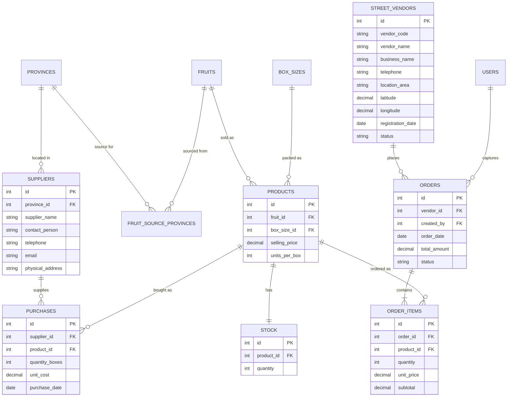
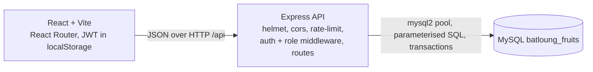
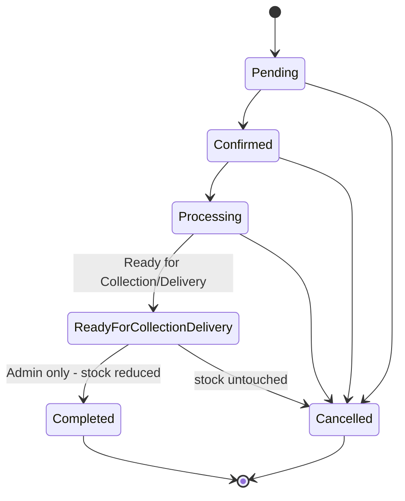

# Batloung Fruits – ERD and system diagrams

## Entity Relationship Diagram

## Architecture

## Order lifecycle (stock rules)

The interface and API enforce each next step. Sales can progress as far as Ready; Administrator completes the order. Completed and Cancelled are terminal. Cancelling before completion leaves stock unchanged.

